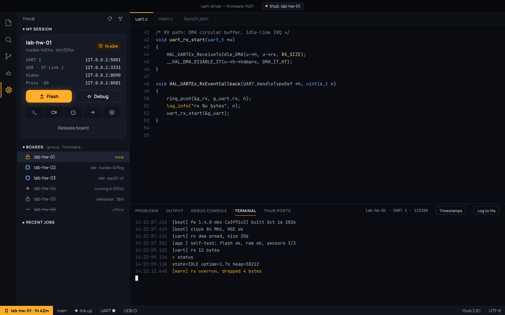

# thub for VS Code

Work on the boards in your **TestHub** lab without leaving the editor: reserve a board, flash and debug it over SWD, use its serial ports, read RTT logs, open forwarded Client services, and watch its camera.



📖 **Full user manual with screenshots:** [docs/user-manual.md](docs/user-manual.md)

## What you need

- **Node.js 24 or newer** and npm: the extension automatically installs and updates the TestHub Agent CLI in VS Code's extension storage. Install the current Node.js 24+ release for your OS from [nodejs.org/download](https://nodejs.org/en/download), make sure Node.js and npm are on `PATH`, and verify with `node --version` and `npm --version`. On Windows, use the Node.js `.msi` installer with npm and Add to PATH selected, then restart VS Code.
- **An access key** for your Coordinator, from your dashboard profile or an admin.
- **An ARM GDB** for flashing and debugging: `arm-none-eabi-gdb` (macOS: `brew install --cask gcc-arm-embedded`), or `gdb-multiarch` (set **thub.gdbPath**).
- **[Cortex-Debug](https://marketplace.visualstudio.com/items?itemName=marus25.cortex-debug)** is installed with the extension; the `thub` debug type hands over to it.
- Optional: **ffmpeg** to show a board's camera in an editor tab. **mpv**, **ffplay** or **vlc** can play it instead, or your browser can.

## Getting started

1. Run **thub: Sign in**, then enter your Coordinator's address and your access key. The key is kept in VS Code's secret storage.
2. Open the **thub** view in the activity bar. You see **My session**, **Boards** and **Recent jobs**.
3. Click an idle resource, or run **thub: Reserve board…**. Pick the HIL or SIL resource, then how long (30m, 2h, 4h, 8h or your own). Leave **Connect right away** on.
4. You can hold one HIL and one SIL reservation at the same time, and connect to both. Each appears under **My session** with its own ports, terminals, camera, forwarded services and **Release board** action.

If you already hold a resource of the same kind, the resource switch dialog lets you choose another. Switching releases only that HIL or SIL lock; a lock of the other kind stays in place.

SIL sessions expose only GDB (debug and flash) and port forwarding. UART, RTT, camera and USB power controls are available only for HIL resources.

On first activation, the extension installs the latest Agent CLI into its global storage; it updates that managed copy if needed Agent features are missing. No global `thub` installation is required. Set **thub.cliPath** only to explicitly use a separately managed CLI. For flashing and debugging on Windows, install a Windows ARM GNU Toolchain and set **thub.gdbPath** to its `arm-none-eabi-gdb.exe` if it isn't on `PATH`. Likewise, set **thub.video.ffmpegPath** or **thub.video.player** to the `.exe` path when optional video tools are not on `PATH`.

While you hold a resource, only your jobs run on it. Ten minutes before either reservation ends, you're offered **Extend 1h** or **Release now** for that resource. When it ends, only its terminals, camera and debug session close.

## Local development

On macOS, run `../bin/update-plugin-locally` from any directory to package the extension, install it into the selected local VS Code profile, verify the installed version, and reload its window. It uses `code` or `code-insiders` from `PATH` (or the standard application install paths); set `VSCODE_CLI` to choose another CLI and `VSCODE_PROFILE` to target a named profile. macOS may ask you to allow Terminal to control VS Code under **System Settings → Privacy & Security → Accessibility**.

## Flash

**thub: Flash** loads your ELF onto the board with GDB's `load`. The ELF is `thub.flashAfterBuild.image`, by default `${workspaceFolder}/build/${workspaceFolderBasename}.elf`.

- Each GDB connection starts its own OpenOCD on the board's Client. The OpenOCD target is **thub.defaultTarget**, or else the probe's target set on the runner card (e.g. `stm32l4x`: the script's name, not the chip's).
- The image is verified with `compare-sections`, then the board is reset and run.
- As a task, use `{"type": "thub", "action": "flash"}`, for example as a `preLaunchTask`.

### Flash after build

Run **thub: Flash after build…** to have a successful build flash the board.
- **When:** choose the build task, the firmware image, and whether to skip an image that hasn't changed.
- **Where:** your reserved board, a named one, or one with a label. You also choose what happens when none is reserved.
- **How:** verify, then reset and run, halt, or start debugging.

The status bar's **Flash after build: on/off** switches it. **thub: Build and flash** does both once.

## Debug

Press F5 with no launch configuration, or add one:

```json
{
  "type": "thub",
  "request": "launch",
  "name": "thub: Debug on reserved board",
  "executable": "${workspaceFolder}/build/${workspaceFolderBasename}.elf",
  "flash": true,
  "runToEntryPoint": "main"
}
```

The extension makes sure the board is reserved and connected, then starts Cortex-Debug against its GDB port. Add `"svdFile"` (or set **thub.debug.svdFile**) to see the chip's peripherals. If the link drops, serial terminals carry on, and you're offered **Reattach debugger**.

## Serial

**thub: Open serial terminal** opens a UART as a terminal, with timestamps (**thub.serial.timestamps**). To log everything a terminal receives to a file, set **thub.serial.logDirectory**.

The same port is a plain TCP socket, `127.0.0.1:5001` and up. Other tools can use it too, for example pyserial's `socket://127.0.0.1:5001`.

## RTT logs

Choose **Add RTT reader…** under **My session** and select an ST-Link. Enter the RAM search start address and size that cover the firmware's SEGGER RTT control block (from its linker map), and the OpenOCD target script if the Client doesn't already have one configured; for an STM32G4, use `stm32g4x`. Channel 0 is the usual log channel. The setup is saved locally per resource and restored on reconnect. Open the **RTT · ST-Link · CH** entry to read the UTF-8 stream in a VS Code terminal. OpenOCD uses the ST-Link exclusively during RTT capture, so close the RTT terminal before debugging or flashing.

## Camera

On a board whose runner has a camera (label `video-stream`), **thub: Open camera** shows it. **thub.video.mode** chooses where:

- **In editor:** a local ffmpeg turns the stream into JPEG frames.
- **External player:** **thub.video.player** (mpv, ffplay or vlc).
- **Browser:** a local page plays it.

The stream's address is unique to your reservation and stops when the reservation ends.

## Ports

The **thub Ports** panel lists every local port of your connected resources (UARTs, GDB, RTT, camera and forwarded services). Use **Add forwarded service…** under **My session** or in the Ports panel, then enter the service name and port on the Client host as `ServiceName:port`, such as `Web UI:3000`. Services are saved locally per resource, restored on reconnect, and can be updated or removed from their tree item or Ports row. Their local tunnel port is assigned automatically; select a service in the tree or choose **Open** in Ports to view its page inside VS Code.

## Limitations

These depend on thub features that don't exist yet. The extension says so instead of pretending:

- **USB power during a reservation.** Power-cycle, On and Off work only while a job of yours runs on the board, because `thub power` is keyed by a job.
- Forwarded services must listen on `127.0.0.1` on the Client host.

## Settings

| Setting | Default | |
| --- | --- | --- |
| `thub.url` | | Your Coordinator. |
| `thub.cliPath` | `thub` on PATH | The thub CLI. |
| `thub.gdbPath` | `arm-none-eabi-gdb` | GDB for flashing and debugging. |
| `thub.defaultTarget` | | OpenOCD target script, e.g. `stm32l4x`. |
| `thub.defaultDuration` | `2h` | Preselected reservation length. |
| `thub.ports.uart` / `.gdb` / `.video` | 5001 / 3333 / 8090 | Local ports; the next free ones if taken. |
| `thub.video.mode` / `.player` / `.ffmpegPath` | `editor` / `mpv` / `ffmpeg` | Where the camera opens. |
| `thub.serial.timestamps` / `.logDirectory` | on / off | Serial terminals. |
| `thub.debug.svdFile` | | The chip's SVD for Cortex-Debug. |
| `thub.flashAfterBuild` | off | See Flash after build. |

Under Remote-SSH, WSL or a dev container, the extension runs where your workspace is. That way `thub`, GDB and your toolchain are all on the same machine.
