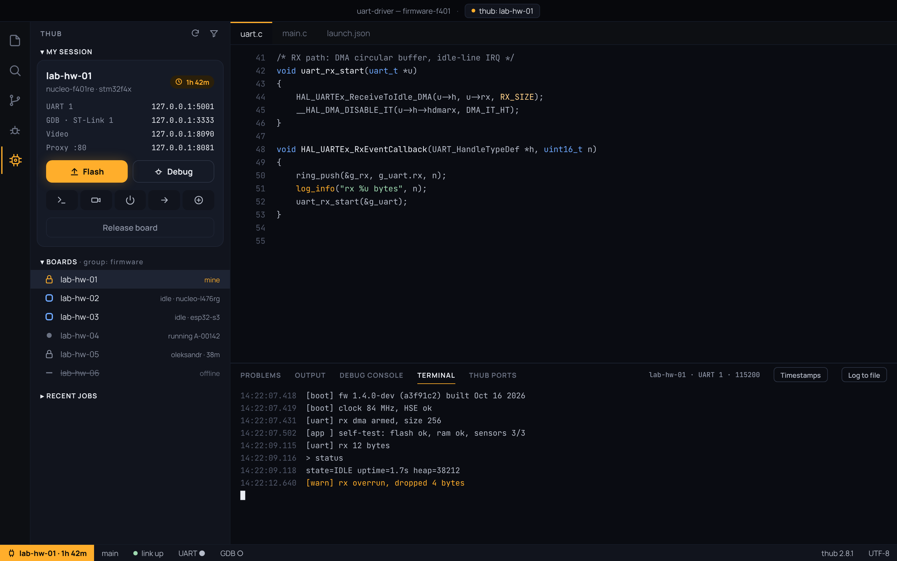

# Design references

UI design for thub for VS Code, exported from the Design canvas
(https://claude.ai/artifact/Dosa1wGfYUMpQDWfLLdbbH). The canvas is the editable
original; this folder is a snapshot for reviews and for implementation.

| # | Artboard | Screenshot | Standalone HTML |
| --- | --- | --- | --- |
| 1 | Workbench: Boards, session, serial | [png](png/Main.png) | [html](html/Main.html) |
| 2 | Flash and debug over thub | [png](png/Debug.png) | [html](html/Debug.html) |
| 3 | Reserve a board (quick pick) | [png](png/Reserve.png) | [html](html/Reserve.html) |
| 4 | Board camera | [png](png/Video.png) | [html](html/Video.html) |
| 5 | Ports and URL proxy | [png](png/Ports.png) | [html](html/Ports.html) |
| 6 | Components and states | [png](png/States.png) | [html](html/States.html) |
| 7 | Flash after build (settings) | [png](png/FlashOnBuild.png) | [html](html/FlashOnBuild.html) |

## Folders

- `png/` — screenshots at 2× scale.
- `html/` — static pages; open in a browser (fonts load from Google Fonts).
- `source/` — the canvas's own files (`canvas.json` and `*.dc.html`), the
  exact source of each artboard. They need the canvas runtime to render; use
  `html/` to view them.

## Notes

- These are mockups, not webview code. Build the real UI with VS Code APIs
  (tree views, terminals, status bar, notifications) and theme variables, as
  described in `CLAUDE.md` → Visual language.
- Power controls during a reservation and custom port forwards depend on thub
  features that don't exist yet (see `CLAUDE.md` → Known gaps).
- When the design changes, re-export all three folders together so they match.
