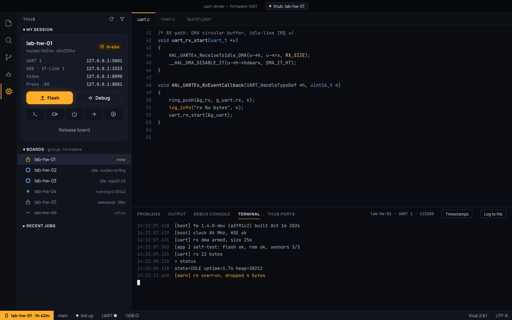
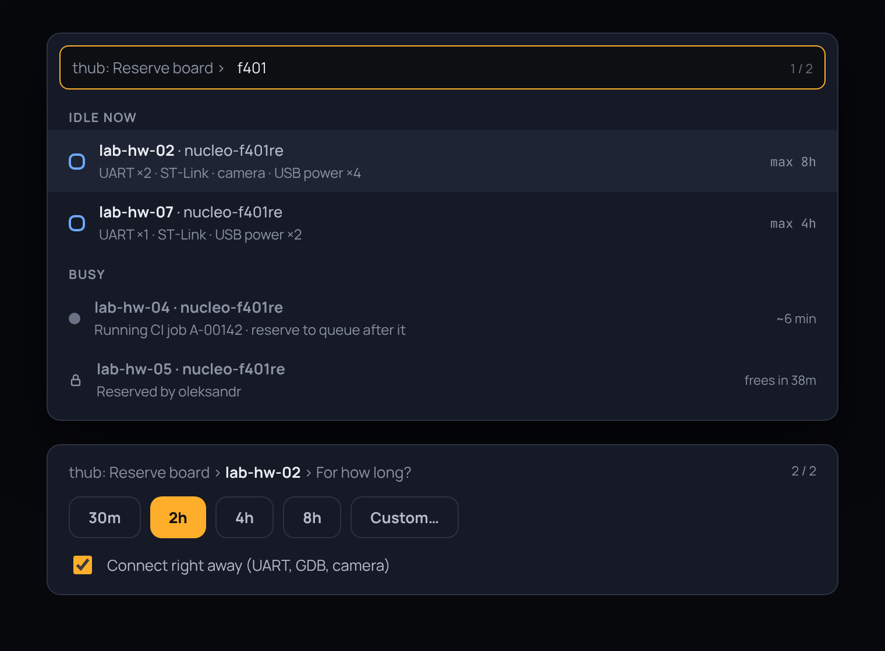
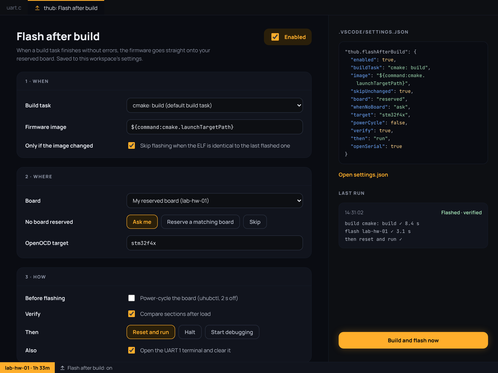
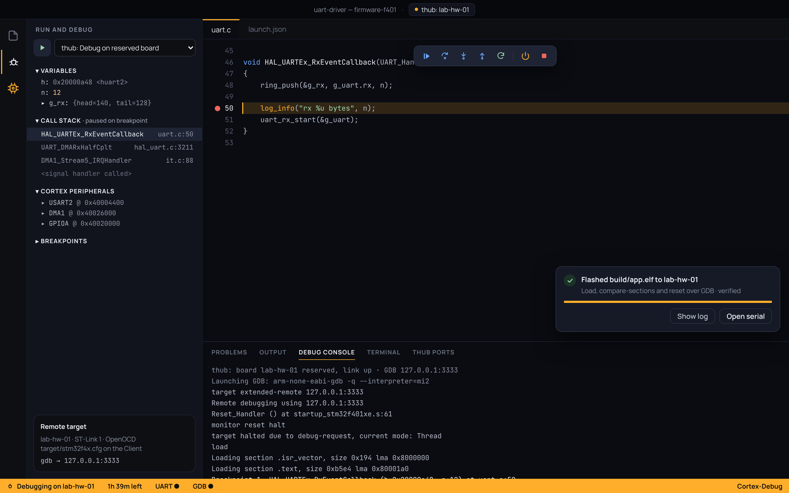
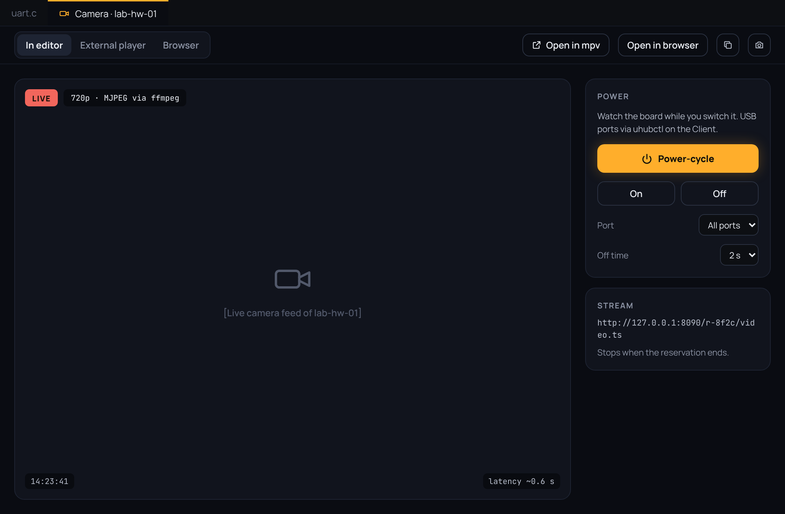
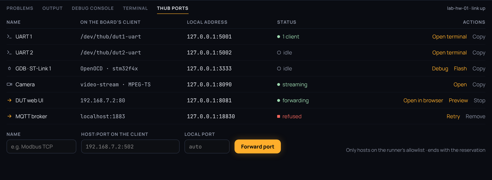

# thub for VS Code — User manual

This manual walks through every feature of the thub extension, in the order you
usually meet them: sign in, reserve a board, connect, flash, debug, use serial,
RTT, camera, forwarded services, and troubleshooting. For a short overview and the
settings table, see the [README](../README.md).

> **Screenshots.** The pictures in this manual are the UI design mockups from
> [design/](design/README.md). They show the intended layout and states; the
> exact look of your VS Code theme may differ. Replace them with live captures
> when available (keep the same file names).

## Contents

1. [Before you start](#1-before-you-start)
2. [Sign in](#2-sign-in)
3. [The thub view](#3-the-thub-view)
4. [Reserve a board](#4-reserve-a-board)
5. [Connect and release](#5-connect-and-release)
6. [Flash](#6-flash)
7. [Flash after build](#7-flash-after-build)
8. [Debug](#8-debug)
9. [Serial terminals](#9-serial-terminals)
10. [RTT logs](#10-rtt-logs)
11. [Camera](#11-camera)
12. [Forwarded services and the Ports panel](#12-forwarded-services-and-the-ports-panel)
13. [USB power](#13-usb-power)
14. [Status bar](#14-status-bar)
15. [Troubleshooting and help](#15-troubleshooting-and-help)
16. [Command reference](#16-command-reference)

---

## 1. Before you start

You need:

- **Node.js 24 or newer** with npm on `PATH`. The extension installs and updates
  the thub Agent CLI for you; you don't install `thub` yourself.
- **An access key** for your Coordinator (from your dashboard profile, or ask an admin).
- **An ARM GDB** for flashing and debugging: `arm-none-eabi-gdb`, or
  `gdb-multiarch`. Set **thub.gdbPath** if it isn't on `PATH`.
- Optional: **ffmpeg** (camera in an editor tab), **mpv**, **ffplay** or **vlc**
  (camera in an external player), or a browser.

## 2. Sign in

Run **thub: Sign in** from the Command Palette (`Cmd/Ctrl+Shift+P`).

1. Enter your Coordinator's address (saved to **thub.url**).
2. Enter your access key. It is stored in VS Code's secret storage, never in settings.

If a command later fails with "sign in", run **thub: Sign in** again. To remove
the key, run **thub: Sign out**.

## 3. The thub view

Open the **thub** icon in the Activity Bar. The view has three sections:



- **My session** — the resources you hold, with their connection state, ports,
  terminals, camera and forwarded services.
- **Boards** — every resource in the lab, grouped by state: idle, mine,
  connecting, reserved by someone else, running a job, or offline. Each state has
  its own icon and label, not just a colour.
- **Recent jobs** — the last jobs run on the lab.

Use the view's refresh action (or **thub: Refresh boards**) to reload. The list
also refreshes every 15 seconds while the view is visible.

You can hold **one HIL and one SIL** resource at the same time. SIL resources
offer GDB and port forwarding only; serial, RTT, camera and power are HIL features.

## 4. Reserve a board

Click an idle board in **Boards**, or run **thub: Reserve board…**.



1. **Pick the board.** Idle boards are listed first, then busy ones.
2. **Pick the duration:** 30 min, 2 h, 4 h, 8 h, or **Custom**. The default is
   **thub.defaultDuration** (`2h`). The maximum is set per runner.
3. **Connect right away** (on by default) starts the session as soon as the board is reserved.

**Extend** (**thub: Extend reservation 1h**) adds an hour from now. You get a
notice ten minutes before the reservation ends, with **Extend 1h** and
**Release now** buttons.

If you already hold a resource of the same kind, the switch dialog lets you
choose another. Switching releases only that one lock.

## 5. Connect and release

After a reservation, **thub: Connect to reserved board** starts the connection
(`thub connect`). Your board's ports then appear under **My session** and in the
Ports panel. The connection restarts automatically if it drops (after 1, 2, 5 and
10 seconds).

**thub: Release board** ends the reservation. Its terminals, camera and debug
session close; other reservations are not affected.

## 6. Flash

**thub: Flash** loads the ELF onto the reserved board with GDB's `load`.

- The image is **thub.flashAfterBuild.image**, by default
  `${workspaceFolder}/build/${workspaceFolderBasename}.elf`.
- The image is checked with `compare-sections`, then the board is reset and run.
- **thub: Build and flash** runs your build task first, then flashes.
- As a task: `{"type": "thub", "action": "flash"}`, for example as a `preLaunchTask`.

If flashing fails, the output shows GDB's messages. Choose **Power-cycle and
retry** if the board is stuck (see [USB power](#13-usb-power)).

Flashing and debugging can't run at the same time. Stop the debug session first,
or flash from it.

## 7. Flash after build

Run **thub: Flash after build…** to have each successful build flash the board.



The settings page is grouped into three sections:

- **When** — the build task to watch (empty means any build task), the image to
  flash, and whether to skip an image that hasn't changed since the last flash.
- **Where** — the reserved board, a named Client, or a board with a label. Also
  choose what happens when no board matches: **ask**, **reserve** a matching idle
  board (1 h), or **skip**.
- **How** — verify the image, then **run**, **halt**, or **debug**. Optionally
  focus the UART 1 terminal after flashing.

The page edits the **thub.flashAfterBuild** setting; `settings.json` stays the
source of truth. A live JSON preview shows the result.

The status bar item **Flash after build: on/off** switches it without opening the
settings. Each run records its time, build duration and result.

## 8. Debug

Press **F5** with no launch configuration, or add this to `.vscode/launch.json`:

```json
{
  "type": "thub",
  "request": "launch",
  "name": "thub: Debug on reserved board",
  "executable": "${workspaceFolder}/build/${workspaceFolderBasename}.elf",
  "flash": true,
  "runToEntryPoint": "main"
}
```



The extension makes sure the board is reserved and connected, then starts
Cortex-Debug against the board's GDB port. Set **thub.debug.svdFile** (or the
`svdFile` launch key) to see the chip's peripherals.

If the link drops during a session, serial terminals keep working and you're
offered **Reattach debugger**. The debug toolbar also has **Power-cycle board**.

## 9. Serial terminals

**thub: Open serial terminal** opens a UART as a VS Code terminal. Timestamps
are controlled by **thub.serial.timestamps**. To log everything to a file, set
**thub.serial.logDirectory**.

The same port is a TCP socket at `127.0.0.1:5001` (and the next ports up for
more UARTs). Other tools can use it, for example pyserial:
`socket://127.0.0.1:5001`. The **Copy** action in the Ports panel copies this address.

## 10. RTT logs

RTT streams firmware logs through SEGGER RTT.

1. Under **My session**, choose **Add RTT reader…** and select an ST-Link.
2. Enter the RAM **search start address** and **size** that cover the firmware's
   SEGGER RTT control block (find it in the linker map). Enter the OpenOCD target
   script if the Client doesn't have one configured, for example `stm32g4x`.
3. Channel 0 is the usual log channel.

Open the **RTT · ST-Link · CH** entry (**Open logs**) to read the UTF-8 stream in
a terminal. The setup is saved per resource and restored on reconnect.

**Note:** OpenOCD uses the ST-Link exclusively while RTT is open. Close the RTT
terminal before you flash or debug.

## 11. Camera

On a board whose runner has the `video-stream` label, run **thub: Open camera**
or use the camera row's **Open video** action.



**thub.video.mode** chooses where the video appears:

- **editor** (default) — a local ffmpeg converts the stream for an editor tab.
- **player** — **thub.video.player** (mpv, ffplay or vlc) plays it.
- **browser** — a local page plays it in your browser.

The stream address is unique to your reservation and stops when the reservation ends.

## 12. Forwarded services and the Ports panel

Forwarding makes a web service on the Client (for example a dashboard on port
3000) reachable from your machine.



1. Under **My session**, choose **Add forwarded service…** (or use the Ports
   panel's **+** button).
2. Enter the service name and the port on the Client host, as `Name:port`, for
   example `Web UI:3000`.
3. Open it with **Open** (opens in a VS Code webview), or **Copy** the URL.
   Update or remove it from the row's actions.

The local port is assigned automatically. The service must listen on
`127.0.0.1` on the Client host.

The **thub Ports** panel lists every local port of your connected resources: UARTs,
GDB, RTT, camera and forwarded services. Each row has icon-only actions. Hover
over an icon to see its name. The camera row has **Open video** and **Copy**;
UART rows have **Open terminal** and **Copy**; GDB rows have **Debug**,
**Flash** and **Copy**.

## 13. USB power

Power controls (**thub: Power-cycle board**, **Power on**, **Power off**) work
only while one of your jobs runs on the board. The thub server doesn't yet allow
power control during an ordinary reservation, so outside a job these actions are
disabled and the tooltip explains why.

## 14. Status bar

The status bar shows:

- the **reservation countdown**, which turns red under 10 minutes;
- **link**, **UART** and **GDB** indicators for the connected board;
- **Flash after build: on/off**, which toggles that feature.

## 15. Troubleshooting and help

| Symptom | What to do |
| --- | --- |
| "Sign in to thub" button appears | Run **thub: Sign in** and check your access key. |
| Boards list is empty | Check **thub.url** and your network; run **thub: Refresh boards**. |
| Ports show "Connecting…" | The board's Client hasn't linked yet. Wait, or run **thub: Connect to reserved board**. |
| Flash or debug fails with GDB errors | Check **thub.gdbPath** and the **thub.defaultTarget** OpenOCD target. Close any open RTT terminal. |
| No camera | The runner needs the `video-stream` label. Check **thub.video.mode** and that ffmpeg (or your player) is installed. |
| Forwarded service won't load | Make sure the service listens on `127.0.0.1` on the Client, and that the Agent CLI supports `--forward` (the panel warns otherwise). |
| RTT is unavailable | The configured Agent CLI is too old. Clear **thub.cliPath** to use the extension-managed CLI. |

For details, run **thub: Show log**. It opens the **thub** output channel, where
the access key is masked. Include its contents when you report a problem.

Get help from your lab administrator, or see the README's
[Limitations](../README.md#limitations) for what thub does not yet support.

## 16. Command reference

| Command | What it does |
| --- | --- |
| thub: Sign in / Sign out | Manage your access key. |
| thub: Refresh boards | Reload the board list. |
| thub: Reserve board… | Reserve an idle board. |
| thub: Extend reservation 1h | Add an hour to your reservation. |
| thub: Release board | End your reservation. |
| thub: Connect to reserved board | Start the connection to your board. |
| thub: Flash | Load the ELF onto the board. |
| thub: Build and flash | Run the build task, then flash. |
| thub: Flash after build… | Configure flashing after each build. |
| thub: Toggle flash after build | Switch flash-after-build on or off. |
| thub: Debug on reserved board | Start a debug session. |
| thub: Reattach debugger | Reconnect the debugger after a link drop. |
| thub: Open serial terminal | Open a UART terminal. |
| thub: Add / Configure / Remove RTT reader | Manage RTT readers. |
| thub: Open RTT logs | Read an RTT stream. |
| thub: Open camera | Show the board camera. |
| thub: Power-cycle / Power on / Power off | USB power (during a job only). |
| thub: Add / Update / Remove forwarded service | Manage forwarded services. |
| thub: Open / Copy forwarded service URL | Use a forwarded service. |
| thub: Copy address | Copy a port's address. |
| thub: Show log | Open the thub output channel. |
